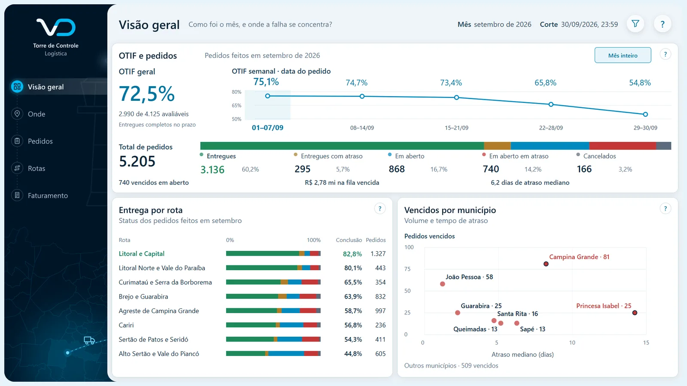

# Torre de Controle Logística

**Como foi o mês e onde a falha se concentra?**

Painel Power BI de demonstração da Vizu Dados, com dados fictícios.

*Logística · do faturamento à entrega*

## O que ele mostra
- OTIF do mês
- Pedidos por status
- Entrega por rota
- Vencidos por município

## Ver o painel
- [Abrir o painel interativo](https://app.powerbi.com/view?r=eyJrIjoiNmQ3ZGVmYjctMjE4Ni00M2M1LThjMDEtZTQ3MDVlZjgxMGMwIiwidCI6IjQ3ZWU2OTdmLWVkNDctNDY2Ni1hNzk2LTJjMTBhNzI2MDMzNCJ9&pageName=pgCapa)
- [Todos os painéis em vizudados.com.br](https://vizudados.com.br/power-bi#torre-de-controle)

Este repositório também guarda as mídias da capa do painel.

© Vizu Dados
